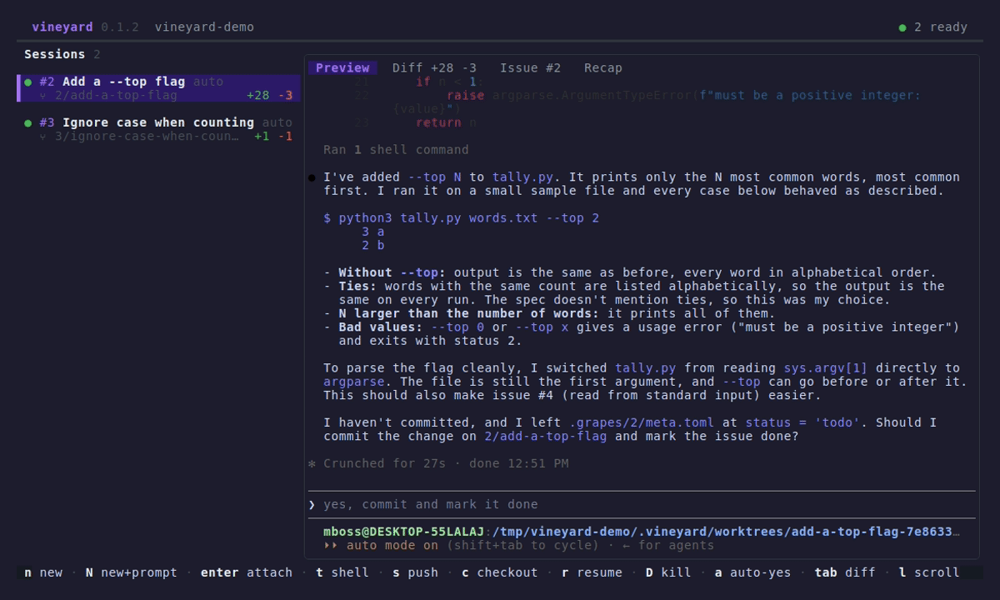

# Vineyard

Run several coding agents in parallel from one terminal. Each agent gets its
own git worktree, branch, and tmux session, so agents never edit the same
checkout. It follows [claude-squad](https://github.com/smtg-ai/claude-squad)'s
model, rebuilt on Bubble Tea v2.



- **Any agent.** Claude Code, Codex, Gemini, Aider, or any other CLI.
- **Live preview.** See each agent's screen, whether it is working or waiting
  for you, and the diff of its branch.
- **Subagents.** Each session counts Claude Code's subagents by status; `→`
  lists them, running or done. Selecting one shows its transcript, the diff
  of the worktree it works in, its issue, and its report; `o` on a running one
  opens its view in Claude Code and attaches. Finished ones stay until your
  next prompt.
- **Issues.** Vineyard embeds the [grapes](https://github.com/Mibokess/grapes)
  issue tracker. Start an agent from an issue, and see which session works on
  which issue.
- **Persistent.** Agents keep running after you quit, in Vineyard's own
  terminal server or in tmux; the next launch picks them up.

## Install

Requires git 2.48 or newer. tmux is optional: Vineyard runs agents in its own
terminal server, and in tmux for sessions you start there.

Download a Linux or macOS build from the
[releases](https://github.com/mikeryanboss/vineyard/releases), or build with
Go 1.25 or newer:

```sh
go install github.com/mikeryanboss/vineyard@latest
```

## Usage

Run `vineyard` inside a git repository.

| Key | Action |
| --- | --- |
| `n` / `N` | New session with the default profile / with a profile you pick, such as a terminal |
| `enter` | Open the shown tab: attach to the agent from Preview, open the diff tool from Diff, the session's issue from Issue, if it has one, the shell from Terminal, the full recap from Recap. On a subagent, attach to its view |
| `o` | Attach to the agent, or the selected subagent's view, from any tab; `ctrl+q` returns |
| `tab` / `shift+tab` | Switch the pane: preview, diff, issue, terminal, recap |
| `l` / `→` | Show the selected session's subagents; with none to show, scroll the pane, and `esc` returns to the list |
| `h` / `←` | Hide the selected session's subagents |
| `t` | Open a shell in the session's worktree; the Terminal tab shows it |
| `T` | Start a new terminal session, the `terminal` profile, and attach to it |
| `s` | Commit all changes and push the branch |
| `c` | Check out: commit, stop the agent, remove the worktree, keep the branch |
| `r` | Resume a checked-out or stopped session; Claude Code continues its conversation |
| `D` | Kill the session; a branch with commits is kept |
| `a` | Toggle auto-yes, which accepts the agent's permission prompts |
| `i` | Open the grapes issues; on an issue, `a` goes to or starts its session |
| `C` | Edit the configuration |
| `q` | Quit; agents keep running |
| `ctrl+q` | Return to the session list from any screen, pane, or dialog, as from an attached agent or shell |

These are the default keys; [Keys](#keys) changes them.

The mouse works too: click a session, a subagent, a tab, a diff file's header
to fold it or its line in the summary to go to it, a dialog's field or answer,
or a config field (click it again to edit it); click `▸ N subagents` to show a
session's subagents and `▾ N subagents` to hide them. A double click acts:
on a session, the preview, or the diff's code it does what `enter` does, on a
subagent it opens the subagent's view, and on a tab it opens the tab, as
`enter` does there. The wheel moves the selection in the list and scrolls the
pane. Scrolling back in the preview reads tmux's scrollback, which an agent
drawing fullscreen, such as Claude Code with `"tui": "fullscreen"`, does not
have; attach to scroll it.

Flags: `-p <command>` runs a different agent in new sessions, `-y` turns on
auto-yes for them, and `-i <id>` opens on grapes issue `<id>` as if you pressed
`a` there. `vineyard debug` prints where Vineyard stores its data.

## Configuration

Each repository keeps its settings in `.vineyard/config.toml`; commit it to
share them. Press `C` to edit it in Vineyard, or edit it by hand:

```toml
default_program = "claude"            # profile name or command
branch_prefix = "mboss/"              # defaults to your username
auto_yes = false
worktree_dir = ".vineyard/worktrees"  # relative to the repository, absolute, or ~/...
diff_command = "hunk diff {base} --watch"  # run by enter on the Diff tab
multiplexer = "vineyard"              # runs new sessions; or "tmux"

disabled_profiles = ["terminal"]     # built-in profiles not to offer

[[profiles]]
name = "codex"
program = "codex"
multiplexer = "tmux"                  # this profile's sessions run in tmux

[[profiles]]
name = "dev server"
program = "npm run dev"
main_checkout = true                  # run in the main checkout, not a new worktree
```

A profile is a command a session runs: an agent, a shell, a dev server. `n`
runs the default; `N` asks which one. Two profiles are built in: `claude`, and
`terminal`, which runs `$SHELL` in the main checkout; `T` starts `terminal`
and attaches to it. Every repository is
offered them after its own `[[profiles]]`; a profile with a built-in one's
name replaces it, and `disabled_profiles` stops offering it.

A profile with `main_checkout` runs in the repository's main checkout, with no
worktree or branch of its own: `D` only stops its program, and `s` and `c`
refuse it. An issue's session (`a` on an issue) is offered only profiles
without it. On the config screen, `w` on a profile toggles `main_checkout`,
and `x` removes a profile, or disables or enables a built-in one.

`diff_command` runs through `sh` in the session's worktree, with `{base}`
replaced by the commit where the session's own work begins: where its branch
forks from `origin/HEAD`, even after a rebase or merge. The default is
[Hunk](https://github.com/modem-dev/hunk). When the command is empty or its
program is not installed, `enter` shows Vineyard's own diff full-screen instead.

`multiplexer` chooses what runs new sessions: `vineyard`, Vineyard's own
terminal server, or `tmux`. A profile's own `multiplexer` overrides it for the
profile's sessions; `m` on a profile in the config screen cycles it. Each
session keeps running where it started, so one Vineyard shows sessions in
both side by side, and changing the setting moves no running session. A
session in tmux when tmux is not installed shows as stopped and cannot start.

### Keys

Every key can be changed. A `[keys.<mode>]` table gives an action the keys
that replace its default ones; `[]` unbinds it. Name keys as Bubble Tea
reports them: `k`, `K` (not `shift+k`), `?`, `enter`, `esc`, `space`, `tab`,
`shift+tab`, `up`, `pgdown`, `f1`, `ctrl+s`, `alt+enter`.

```toml
[keys.list]
kill = ["x"]
auto_yes = []         # no key toggles auto-yes

[keys.global]
detach = ["ctrl+g"]   # leave an attached terminal with ctrl+g
```

The status bar and messages show the keys bound. Vineyard rejects keys that
cannot work, as it rejects a malformed file: an unknown mode or action, a
key two actions of one mode share, a key `global.quit` or `global.back`
takes before every screen, or a detach key that is not ctrl and a letter (except `ctrl+i` and
`ctrl+m`, which terminals send for tab and enter). The config screen shows
the error. Keys typed into a text field move its cursor and edit it as usual,
and grapes' issues screen has its own keys in `.grapes/config.toml`.

<details>
<summary>Every mode, action, and default key</summary>

<!-- default keys: keep equal to config.DefaultKeys; TestREADMEListsTheDefaultKeys checks -->
```toml
[keys.global]  # everywhere
quit = ["ctrl+c"]                           # quits from any screen, before any other key
back = ["ctrl+q"]                           # returns to the session list from any screen
detach = ["ctrl+q"]                         # leaves an attached terminal; ctrl and a letter

[keys.list]  # the session list
up = ["k", "up"]
down = ["j", "down"]
new = ["n"]
new_from_profile = ["N"]
terminal = ["T"]                            # start and attach a terminal session
open = ["enter"]                            # open the shown tab
attach = ["o"]
shell = ["t"]
kill = ["D"]
checkout = ["c"]                            # commit, stop, remove the worktree
resume = ["r"]
push = ["s"]
auto_yes = ["a"]
next_tab = ["tab"]
prev_tab = ["shift+tab"]
expand = ["l", "right"]                     # show subagents, or focus the pane
collapse = ["h", "left"]                    # hide subagents
config = ["C"]                              # the config screen
issues = ["i"]
quit = ["q"]

[keys.pane]  # a pane with focus: preview, diff, issue, terminal, recap
up = ["k", "up"]
down = ["j", "down"]
half_up = ["ctrl+u", "pgup"]
half_down = ["ctrl+d", "pgdown", "space"]
top = ["g", "home"]
bottom = ["G", "end"]                       # back to live in the preview
next_file = ["]", "n"]
prev_file = ["[", "p"]
fold = ["enter", "o"]                       # fold a diff file
fold_all = ["c"]
unfold_all = ["e"]
next_tab = ["tab"]
prev_tab = ["shift+tab"]
back = ["esc", "h", "left", "q"]

[keys.settings]  # the config screen
up = ["k", "up"]
down = ["j", "down"]
left = ["h", "left"]                        # to the categories
right = ["l", "right"]                      # to the fields
next_pane = ["tab"]
edit = ["enter"]
remove = ["x", "delete"]                    # remove, disable, or enable a profile
where = ["w"]                               # toggle a profile's main_checkout
multiplexer = ["m"]                         # cycle a profile's multiplexer
save = ["ctrl+s"]
back = ["esc"]

[keys.form]  # the new-session dialog, and typing a config value
submit = ["enter"]                          # create, or confirm a value
cancel = ["esc"]
next_field = ["tab"]
prev_field = ["shift+tab"]
prev_option = ["left", "h"]                 # previous profile or template
next_option = ["right", "l"]                # next profile or template
newline = ["alt+enter", "ctrl+j"]           # a new line in the prompt
toggle = ["space"]                          # tick Build sub-issues

[keys.confirm]  # a yes/no question
yes = ["y", "Y", "enter"]
no = ["n", "N", "esc", "q"]

[keys.pick]  # choosing one of several options
up = ["k", "up"]
down = ["j", "down"]
choose = ["enter"]
cancel = ["esc", "q"]
```

</details>

### Prompt templates

`a` on an issue without a session opens the new-session dialog with a prompt
rendered from a template. Each `.md` file in `.vineyard/templates/` is a
template named after the file; `config.toml` can add more:

```toml
[[templates]]
name = "plan"
text = """
Plan grapes issue #{{.ID}}: {{.Title}}. Do not change code yet.
"""
```

When `.vineyard/templates/` is missing, Vineyard creates it with three
examples, `default`, `bug`, and `research`; edit, delete, or add to them, and
commit them to share them. The dialog preselects the template named after the
issue's first label that has one, else `default`; `←/→` on the Template field
picks another. For an issue with sub-issues, the Build sub-issues checkbox
(`space`) tells the agent to build the sub-issues no other session works on.
Changing the template or the checkbox renders the prompt again, replacing your
edits.

Templates are Go [`text/template`](https://pkg.go.dev/text/template)s over:

| Field | Value |
| --- | --- |
| `.ID`, `.Title`, `.Status` | the issue |
| `.Labels` | its labels |
| `.Parent` | its parent's `.ID`, `.Title`, and `.Status`, or nil |
| `.SubIssues` | each sub-issue's `.ID`, `.Title`, `.Status`, and `.Branch`, the branch of a session working on it or empty |
| `.Blockers` | the issues it is blocked by that are neither done nor cancelled |
| `.BuildSubIssues` | whether Build sub-issues is ticked |

Vineyard removes trailing spaces and repeated blank lines from the result, so
conditional paragraphs need no whitespace control.

A session for an issue starts only when the issue is committed at HEAD, so its
worktree has it.

A `.vineyard/.gitignore` written before templates existed ignores them: add
`!templates/` and `!templates/*` to it, or delete it and Vineyard writes the
current one.

## How it works

A session is a branch, a worktree under `worktree_dir`, and the agent running
in a detached terminal of a multiplexer. By default that is Vineyard's own
terminal server, which works like tmux's: it runs in the background, runs each
agent on a pseudo-terminal, mirrors it with a built-in terminal emulator, and
keeps running after Vineyard quits until its last agent ends. `vineyard debug`
prints its socket. A session in tmux runs on Vineyard's own tmux server
(`tmux -L vineyard ls`). The preview mirrors the agent's screen. An agent whose
screen keeps changing is working; one whose screen is still is waiting for
you. Attaching hands the terminal to the agent until the detach key, ctrl+q by default.

You can run several Vineyards on one repository, for example one per terminal
window; they share the session list and show each other's changes within a
second. Vineyard keeps that list and its lock files in `.vineyard/`, and writes
a `.vineyard/.gitignore` so that only the configuration reaches git.

Contributors: see [docs/README.md](docs/README.md).
